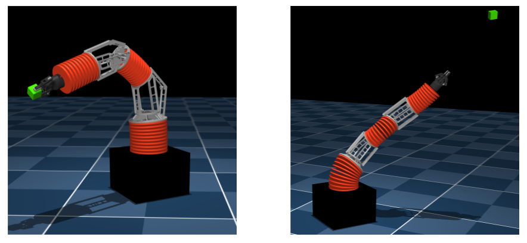
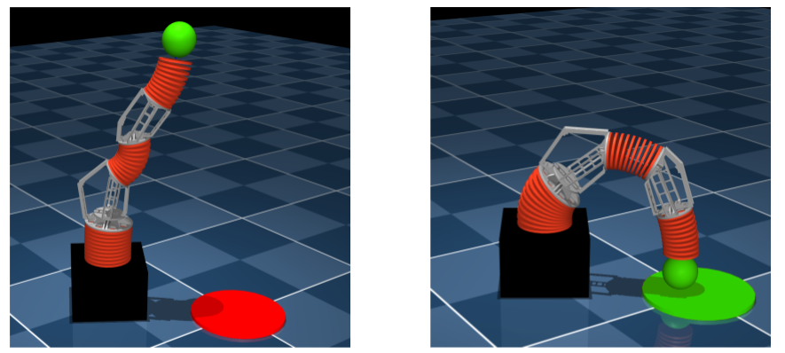

# Bellows Arm Control

Simulated environment and optimization code for the paper  
### Learning Dynamic Tasks on a Large-scale Soft Robot in a Handful of Trials - [Project Page](https://sites.google.com/view/bayesoptsoftrobotcontrol)
**Abstract**
Soft robots offer more flexibility, compliance, and adaptability than traditional rigid robots. They are also typically lighter and cheaper to manufacture. However, their use in real-world applications is limited due to modeling challenges and difficulties in integrating effective proprioceptive sensors. Large-scale soft robots ($\approx$ two meters in length) have greater modeling complexity due to increased inertia and related effects of gravity. Common efforts to ease these modeling difficulties such as assuming simple kinematic and dynamics models also limit the general capabilities of soft robots and are not applicable in tasks requiring fast, dynamic motion like throwing and hammering. To overcome these challenges, we propose a data-efficient Bayesian optimization-based approach for learning control policies for dynamic tasks on a large-scale soft robot. Our approach optimizes the task objective function directly from commanded pressures, without requiring approximate kinematics or dynamics as an intermediate step. We demonstrate the effectiveness of our approach through both simulated and real-world experiments.

## Environments
**Throwing Task:**

<div align="center" style="display: flex; justify-content: center; align-items: flex-start;">


</div>

**Hammering Task:**

<div align="center" style="display: flex; justify-content: center; align-items: flex-start;">


</div>

## Installation
*Instructions tested on Ubuntu and Python 3.10+*

1. Clone the repo. This project uses `uv` for dependency management, which is an extremely fast Python package installer and resolver. You can find installation instructions for `uv` [here](https://docs.astral.sh/uv/getting-started/installation/).

2. Install the dependencies using `uv`:
```bash
uv sync --all-extras
```

3. Test the simulation. There are two ways to interactively inspect the simulated arm:

   - **Via `simulate_env.py` (`dm_control` composer):** Builds the arm dynamically depending on the task (`throw`, `smash`, or `reach`) using `dm_control`'s composer. The composer environments handle stepping the dynamics and computing task rewards.

     ```bash
     uv run python simulate_env.py
     ```
     *(It may require pressing the spacebar to unpause.)*

   - **Via `simulate.py` (plain MuJoCo):** A plain MuJoCo sandbox using `mujoco-python-viewer` with MJCF files, providing low-level control over `MjModel` and `MjData`.

     ```bash
     uv run python src/bellows_arm_control/mujoco/simulate.py
     ```

## Running Experiments

Experiment scripts are located in the `experiments/` directory. By default, metrics (`episode_return`, `best_observed`, and learned pressure commands) are logged to **TensorBoard** under `runs/` and saved as `.npz` files under `data/`. You can also enable **Weights & Biases** logging by passing `--use_wandb`.

### 1. Bayesian Optimization (`experiments/run_bo.py`)

Run Bayesian Optimization with Upper Confidence Bound (`UCB`) or Log Expected Improvement (`LEI`) on the Throwing (`throw`) or Hammering (`smash`) task:

```bash
# Throwing task with BayesOpt-UCB (50 optimization trials after 12 initial random trials, P=5 pressure values)
uv run python experiments/run_bo.py --env=throw --acq_func=UCB --act_discretization=5 --num_init_points=12 --num_trials=50 --seed=1234

# Hammering task with BayesOpt-LEI
uv run python experiments/run_bo.py --env=smash --acq_func=LEI --act_discretization=5 --num_init_points=12 --num_trials=50 --seed=1234
```

You can also choose how the acquisition function is optimized via `--acq_optim` (`botorch` L-BFGS-B by default, `cem` for `BayesOptCEM`, or `cmaes` for `BayesOptCMAES`):

```bash
uv run python experiments/run_bo.py --env=throw --acq_func=UCB --acq_optim=cem --act_discretization=5 --num_trials=50
```

### 2. Global Optimization Baselines (`experiments/run_go.py`)

Run the Cross-Entropy Method (`CEM`) or Random Search (`RS`) baselines:

```bash
# Cross-Entropy Method (CEM) on the Throwing task (population size 50, elite ratio 0.2, 250 trials)
uv run python experiments/run_go.py --env=throw --algo=CEM --act_discretization=5 --population_size=50 --elite_ratio=0.2 --num_trials=250 --seed=1234

# Random Search (RS) on the Hammering task
uv run python experiments/run_go.py --env=smash --algo=RS --act_discretization=5 --population_size=50 --num_trials=250 --seed=1234
```

### 3. Reproducing Paper Benchmark Sweeps (`experiments/run_sweep.py`)

To reproduce the simulated benchmark results across tasks (`throw`, `smash`), pressure discretizations ($P \in \{2, 5, 7, 10\}$), algorithms (`BayesOpt-UCB`, `BayesOpt-LEI`, `CEM`, `RS`), and seeds (`1234, 42, 1337, 69, 420`) reported in **Tables I & II** of the paper:

```bash
# Preview the sweep commands without executing them
uv run python experiments/run_sweep.py --dry_run

# Run the sweep for the Throwing task with P=5 across all 5 seeds
uv run python experiments/run_sweep.py --envs=throw --discretizations=5 --num_workers=2

# Run the full paper sweep across all tasks, pressure discretizations, and seeds
uv run python experiments/run_sweep.py --num_workers=4
```

### 4. Viewing Logs

To inspect learning curves and commanded pressure trajectories in TensorBoard:

```bash
uv run tensorboard --logdir runs
```

## Running Tests

```bash
uv run pytest
```

## ToDo's

- [X] Add Mujoco environments
- [X] Add BayesOpt Code
- [X] Add Global Optimization baselines (CEM, Random Search, CMA-ES)

## Bibtex
If you find this useful, please cite the paper!
```bibtex
@inproceedings{Zwane2024,
 author = {Sicelukwanda Zwane and Daniel G. Cheney and Curtis C Johnson and Yicheng Luo and Yasemin Bekiroglu and Marc Killpack and Marc P. Deisenroth},
 booktitle = {Proceedings of the International Conference on Intelligent Robots and Systems (IROS)},
 date = {2024-10-14},
 title = {Learning Dynamic Tasks on a Large-scale Soft Robot in a Handful of Trials},
 year = {2024}
}
```
